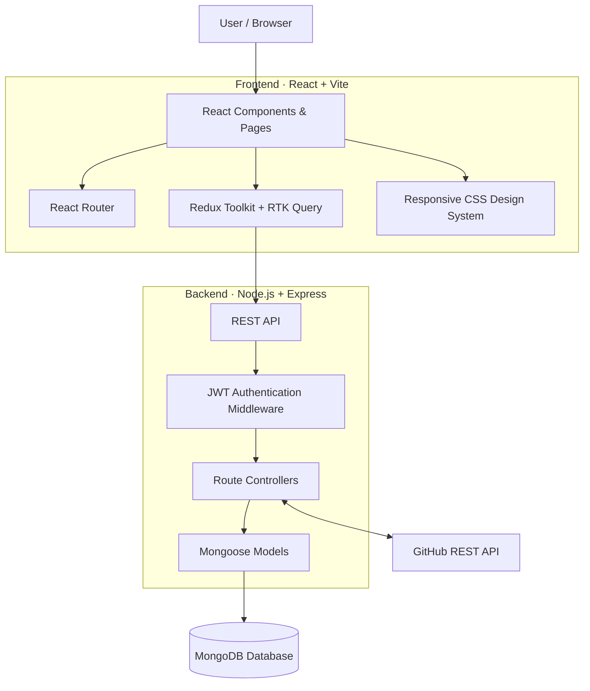
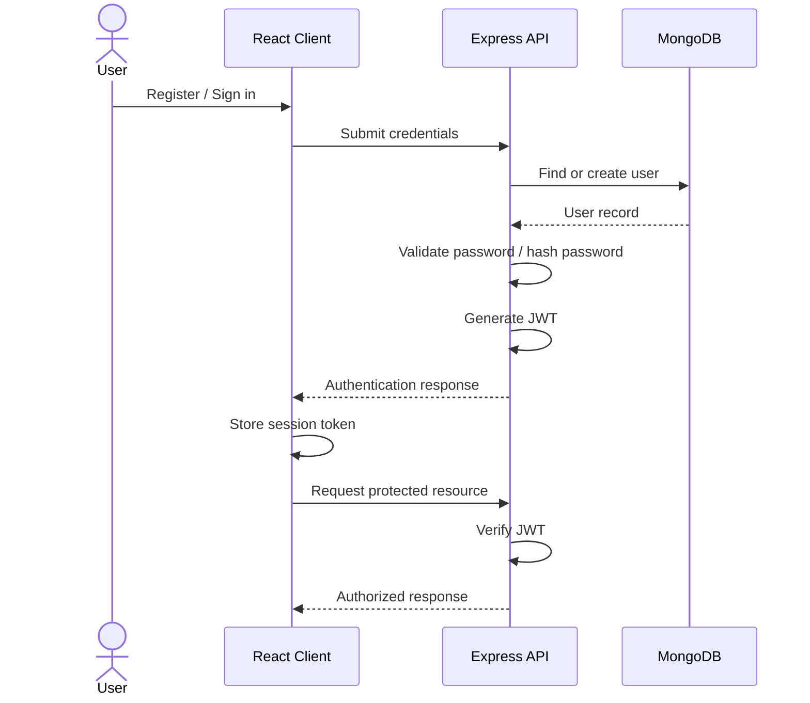

<div align="center">

# ✦ DevPulse

### YOUR DEVELOPMENT WORKSPACE. ONE CLEAR PULSE.

**Plan projects. Move tasks. Collaborate with your team. Stay connected to GitHub.**

A developer productivity workspace that brings project management, task tracking, team collaboration, and GitHub activity together in one beautifully organized application.

<br />

<a href="https://devpulse-flax-two.vercel.app">
  
</a>
<a href="https://github.com/Sujaltonge384/Devpulse">
  
</a>

<br /><br />


<br /><br />

**A calmer command center for everything you build.**

</div>

---

## ◈ Table of Contents

- [Overview](#-overview)
- [See DevPulse in Action](#-see-devpulse-in-action)
- [What Makes DevPulse Special](#-what-makes-devpulse-special)
- [Features](#-features)
- [GitHub Integration](#-github-integration)
- [Technology Stack](#-technology-stack)
- [Architecture](#-architecture)
- [Project Structure](#-project-structure)
- [Getting Started](#-getting-started)
- [Environment Variables](#-environment-variables)
- [GitHub OAuth Setup](#-github-oauth-setup)
- [API Overview](#-api-overview)
- [Deployment](#-deployment)
- [Security](#-security)
- [Future Scope](#-future-scope)
- [Contributing](#-contributing)
- [Author](#-author)

---

## ◈ Overview

**DevPulse** is a full-stack developer productivity platform designed to organize the everyday development workflow.

Developers often switch between multiple tools to manage projects, maintain task lists, check deadlines, collaborate with teammates, and monitor GitHub activity.

DevPulse brings these workflows into a single workspace.

It combines a project and task management system with GitHub integration, productivity analytics, shared team projects, notifications, and a searchable activity center.

Instead of simply tracking what needs to be done, DevPulse helps developers understand what is happening across their work.

### The idea behind DevPulse

> Good development is not just about writing code. It is about organizing work, maintaining momentum, and knowing what deserves attention next.

**Live Application:** https://devpulse-flax-two.vercel.app

**Backend API:** https://devpulse-kr3o.onrender.com

**GitHub Repository:** https://github.com/Sujaltonge384/Devpulse

---

## ◈ See DevPulse in Action

A look at the actual application interface.

<table>
  <tr>
    <td width="50%" align="center">
      <h3>01 · Developer Dashboard</h3>
      <p>Productivity overview, project progress, workload analytics, and deadlines.</p>
      <a href="https://github.com/user-attachments/assets/a45bf8af-7309-4733-8b8d-af06260f30cc">
        
      </a>
    </td>
    <td width="50%" align="center">
      <h3>02 · Project Management</h3>
      <p>Create projects, organize initiatives, and monitor completion progress.</p>
      <a href="https://github.com/user-attachments/assets/3155985d-9d46-43ea-818b-f02399b7a737">
        
      </a>
    </td>
  </tr>
  <tr>
    <td width="50%" align="center">
      <h3>03 · Task Management</h3>
      <p>Kanban board, task priorities, deadlines, filters, and list view.</p>
      <a href="https://github.com/user-attachments/assets/31c37349-023d-4d51-a440-430457154772">
        
      </a>
    </td>
    <td width="50%" align="center">
      <h3>04 · GitHub Workspace</h3>
      <p>Repository discovery, commits, pull requests, and PR triage.</p>
      <a href="https://github.com/user-attachments/assets/5052e0a2-fd83-4f57-839a-c845e8c381c7">
        
      </a>
    </td>
  </tr>
  <tr>
    <td width="50%" align="center">
      <h3>05 · Notifications & Activity</h3>
      <p>Stay informed about workspace changes and recent development activity.</p>
      <a href="https://github.com/user-attachments/assets/c53bf6bd-b1ef-4002-b764-cd10ffc19e0f">
        
      </a>
    </td>
    <td width="50%" align="center">
      <h3>06 · Help Center</h3>
      <p>Searchable guides and categorized answers for using DevPulse.</p>
      <a href="https://github.com/user-attachments/assets/92e4162e-98b5-4fa3-9b90-8f376ca5169f">
        
      </a>
    </td>
  </tr>
</table>

---

## ◈ What Makes DevPulse Special?

DevPulse is built around the idea that project management and development activity should not live in completely separate places.

| Capability | What it brings |
|---|---|
| **Unified Workspace** | Projects, tasks, deadlines, and developer activity in one application. |
| **Visual Task Workflow** | Move tasks through a drag-and-drop Kanban board or work in list view. |
| **GitHub Integration** | Access repository information, recent commits, pull requests, and GitHub activity. |
| **PR-to-Task Workflow** | Convert a GitHub pull request into a trackable DevPulse task. |
| **Team Collaboration** | Share projects with existing DevPulse users and collaborate on tasks. |
| **Productivity Insights** | Understand task completion, workload distribution, priorities, and overdue items. |
| **Personalized Workspace** | Switch between light and dark themes and manage account preferences. |

### One workflow, connected together

```text
              DEVPULSE WORKSPACE
                      |
       +--------------+--------------+
       |              |              |
    PROJECTS         TASKS          TEAM
       |              |              |
       +--------------+--------------+
                      |
              DEVELOPER ACTIVITY
                      |
              GITHUB INTEGRATION
                      |
              PR → DEVPULSE TASK
                      |
              PRODUCTIVITY VIEW
```

---

## ◈ Features

### 01. Developer Dashboard

Your central command center for understanding the state of your work.

- Active project overview.
- Total tasks and task completion statistics.
- Tasks waiting to start and tasks in progress.
- High-priority work requiring attention.
- Overall completion percentage.
- Project-wise progress indicators.
- Workload distribution by task status.
- Priority and overdue task breakdown.
- Seven-day productivity chart.
- Recently updated tasks.
- Quick access to create projects.

The dashboard helps you identify what is moving, what is pending, and what requires attention.

### 02. Project Management

Give every development initiative its own organized space.

- Create projects with names and descriptions.
- Assign project colors for visual organization.
- Update project information.
- Track project status:
  - Active
  - Completed
  - Archived
- Monitor completed and total task counts.
- View project progress percentages.
- Search and filter projects.
- Open tasks belonging to a particular project.
- Delete projects when they are no longer needed.

### 03. Smart Task Management

Organize development work using a visual task workflow.

**Kanban Board**

Tasks are organized into three workflow columns:

| Status | Meaning |
|---|---|
| To Do | Work waiting to begin. |
| In Progress | Work currently being handled. |
| Done | Completed work. |

**Task capabilities**

- Create and edit tasks.
- Drag and drop cards between Kanban columns.
- Switch between Board and List views.
- Assign tasks to projects.
- Set task priorities:
  - High
  - Medium
  - Low
- Set due dates.
- Track overdue tasks.
- Search tasks by title.
- Filter by project, status, and priority.
- Delete tasks with confirmation.

### 04. Team Collaboration

DevPulse supports shared project workspaces.

- Invite existing DevPulse users using their registered email.
- View project owners and collaborators.
- Share project visibility with team members.
- Allow members to create and update shared tasks.
- Allow project owners to manage collaborators.
- Remove members from projects.
- Allow members to leave shared projects.

**Permission model**

| Role | Permissions |
|---|---|
| Project Owner | Manage project details and collaborators; manage project tasks. |
| Project Member | View shared project and create/update tasks. |
| Task Creator | Delete tasks they created, subject to project access. |

### 05. GitHub Integration

Connect your GitHub account and bring repository activity into your developer workspace.

- GitHub OAuth authentication.
- View connected GitHub account information.
- Browse accessible repositories.
- View repository descriptions, languages, visibility, stars, and update dates.
- Inspect recent commits for a selected repository.
- View recent public GitHub account events.
- Discover open pull requests from accessible repositories.
- Track pull request priority and triage status inside DevPulse.
- Convert pull requests into DevPulse tasks.
- Disconnect your GitHub account.

### 06. Pull Request Triage

A dedicated workflow for organizing pull requests.

**Priority levels**

- Urgent
- High
- Medium
- Low

**Triage statuses**

- Backlog
- Planned
- In Progress
- Done
- Ignored

Priorities and triage status are stored in DevPulse. This lets you organize your review workflow without changing the status of the actual GitHub pull request.

**PR-to-task workflow**

```text
GitHub Pull Request
        |
        v
   Review PR details
        |
        v
  Set priority & status
        |
        v
 Select DevPulse project
        |
        v
    Create task
        |
        v
 Track it in Kanban
```

### 07. Calendar & Deadlines

A calendar-based view of your task schedule.

- Monthly calendar navigation.
- View tasks by due date.
- Identify days with scheduled work.
- Inspect tasks due on a selected date.
- Review upcoming deadlines.
- Highlight overdue tasks.
- Navigate between months.

### 08. Notifications & Activity

Keep track of what happens across your workspace.

**Notifications**

- View recent notifications.
- Unread notification count.
- Mark individual notifications as read.
- Mark all notifications as read.
- Notification dropdown in the main navigation.

**Activity feed**

- Task activity.
- Project changes.
- GitHub-related activity.
- Team collaboration events.
- Chronological activity history.
- Filter activity by category.

### 09. Workspace Search

Find project and task information without navigating through every section.

- Search project names and descriptions.
- Search task titles and descriptions.
- View separate project and task results.
- Open the relevant workspace section from a result.
- Search results update as you type.

### 10. Personalization & Help Center

**Settings**

- View account details.
- Switch between light and dark themes.
- Manage your active session.
- View integration information.

**Help Center**

- Search help articles.
- Browse categorized support topics.
- Expand frequently asked questions.
- Getting Started guidance.
- Project and task guidance.
- Team and GitHub information.
- Account security.
- Troubleshooting.

---

## ◈ Technology Stack

DevPulse follows a client-server architecture with a React-based frontend and an Express REST API.

### Frontend

| Technology | Purpose |
|---|---|
| React 18 | Component-based user interface. |
| Vite 6 | Frontend development server and build tooling. |
| React Router | Client-side routing and navigation. |
| Redux Toolkit | Centralized application state. |
| RTK Query | API requests, caching, and server-state management. |
| Lucide React | Consistent interface icons. |
| Vanilla CSS | Responsive layouts, themes, components, and styling. |
| CSS Custom Properties | Reusable design tokens and light/dark themes. |

### Backend

| Technology | Purpose |
|---|---|
| Node.js | JavaScript runtime. |
| Express.js | REST API and route handling. |
| MongoDB | Persistent application database. |
| Mongoose | MongoDB object modeling and schemas. |
| JWT | Authentication tokens. |
| bcryptjs | Password hashing. |
| Helmet | HTTP security headers. |
| CORS | Cross-origin request configuration. |
| Cookie Parser | Cookie handling. |
| Morgan | HTTP request logging. |
| Express Rate Limit | Request rate limiting. |
| dotenv | Environment configuration. |

### Integrations & Deployment

| Technology | Purpose |
|---|---|
| GitHub OAuth | Authorize GitHub account connections. |
| GitHub REST API | Retrieve repositories, commits, pull requests, and events. |
| AES-256-GCM | Encrypt stored GitHub access tokens. |
| Vercel | Frontend hosting. |
| Render | Backend hosting. |
| MongoDB Atlas / MongoDB | Database hosting. |
| Git & GitHub | Source control and collaboration. |

### Styling Philosophy

DevPulse uses a custom CSS design system instead of relying on a utility-first CSS framework.

- CSS custom properties for consistent colors and theme tokens.
- Dedicated light and dark themes.
- Responsive CSS Grid and Flexbox layouts.
- Reusable buttons, cards, navigation, badges, and modal patterns.
- Responsive sidebar and mobile navigation.
- Consistent iconography through Lucide React.

---

## ◈ Architecture

### High-Level Architecture



### Application Flow

1. The user interacts with the React frontend.
2. React Router manages the application pages.
3. RTK Query handles API communication.
4. Express receives API requests.
5. Authentication middleware validates protected requests.
6. Route handlers process application operations.
7. Mongoose communicates with MongoDB.
8. GitHub routes communicate with the GitHub REST API when requested.

### Authentication Flow



---

## ◈ Project Structure

```text
DevPulse/
│
├── client/
│   ├── public/
│   │
│   ├── src/
│   │   ├── api/
│   │   │   └── baseApi.js
│   │   │
│   │   ├── app/
│   │   │   └── store.js
│   │   │
│   │   ├── features/
│   │   │   ├── extended/
│   │   │   │   └── WorkspacePages.jsx
│   │   │   │
│   │   │   └── ui/
│   │   │       └── uiSlice.js
│   │   │
│   │   ├── pages/
│   │   │   ├── HelpCenter.jsx
│   │   │   └── HelpCenter.css
│   │   │
│   │   ├── App.jsx
│   │   ├── index.css
│   │   └── main.jsx
│   │
│   ├── index.html
│   ├── package.json
│   ├── vercel.json
│   └── .env.example
│
├── server/
│   ├── src/
│   │   ├── config/
│   │   │   └── db.js
│   │   │
│   │   ├── middleware/
│   │   │   ├── auth.js
│   │   │   └── errors.js
│   │   │
│   │   ├── models/
│   │   │   ├── User.js
│   │   │   ├── Project.js
│   │   │   ├── Task.js
│   │   │   ├── Activity.js
│   │   │   ├── Notification.js
│   │   │   └── GitHubTriage.js
│   │   │
│   │   ├── routes/
│   │   │   ├── auth.routes.js
│   │   │   ├── dashboard.routes.js
│   │   │   ├── projects.routes.js
│   │   │   ├── tasks.routes.js
│   │   │   ├── team.routes.js
│   │   │   ├── github.routes.js
│   │   │   ├── activity.routes.js
│   │   │   ├── notifications.routes.js
│   │   │   ├── search.routes.js
│   │   │   └── health.routes.js
│   │   │
│   │   ├── utils/
│   │   │   └── activity.js
│   │   │
│   │   └── server.js
│   │
│   ├── package.json
│   └── .env.example
│
├── docs/
│   ├── API.md
│   └── TESTING.md
│
├── package.json
├── package-lock.json
└── README.md
```

---

## ◈ Getting Started

Want to run DevPulse locally? Follow these steps.

### Prerequisites

Install the following before starting:

- [Node.js](https://nodejs.org/)
- npm
- [MongoDB Atlas](https://www.mongodb.com/atlas) or a local MongoDB instance
- [Git](https://git-scm.com/)

### 1. Clone the Repository

```bash
git clone https://github.com/Sujaltonge384/Devpulse.git

cd Devpulse
```

### 2. Install Dependencies

From the project root:

```bash
npm run install:all
```

This installs the root, frontend, and backend dependencies.

### 3. Configure Environment Variables

Create the backend environment file:

```bash
# Windows PowerShell
Copy-Item server/.env.example server/.env
```

Create the frontend environment file:

```bash
# Windows PowerShell
Copy-Item client/.env.example client/.env
```

### 4. Configure the Frontend

Open `client/.env`:

```env
VITE_API_URL=http://localhost:5000/api
```

This tells the React application where the backend API is running.

### 5. Configure the Backend

Open `server/.env`:

```env
NODE_ENV=development
PORT=5000

CLIENT_URL=http://localhost:5173
CLIENT_URLS=

MONGODB_URI=your_mongodb_connection_string

JWT_SECRET=your_long_random_secret

GITHUB_CLIENT_ID=
GITHUB_CLIENT_SECRET=
GITHUB_CALLBACK_URL=http://localhost:5000/api/github/callback

GITHUB_TOKEN_ENCRYPTION_KEY=
```

Replace the placeholder values with your own configuration.

### 6. Generate Secure Secrets

Generate a JWT secret:

```bash
node -e "console.log(require('crypto').randomBytes(64).toString('hex'))"
```

Generate a GitHub token encryption key:

```bash
node -e "console.log(require('crypto').randomBytes(32).toString('hex'))"
```

Copy the generated values into `server/.env`.

**Never commit your actual `.env` files or expose these values in frontend code.**

### 7. Start DevPulse

Run both applications together:

```bash
npm run dev
```

Or start them individually in separate terminals:

**Terminal 1 — Backend**

```bash
npm run dev:server
```

**Terminal 2 — Frontend**

```bash
npm run dev:client
```

### 8. Open the Application

| Service | Local URL |
|---|---|
| DevPulse Frontend | http://localhost:5173 |
| Backend API | http://localhost:5000 |
| Health Check | http://localhost:5000/api/health |

---

## ◈ GitHub OAuth Setup

DevPulse uses GitHub OAuth to connect user accounts.

### Create a GitHub OAuth App

1. Open GitHub Settings.
2. Navigate to **Developer Settings → OAuth Apps**.
3. Create a new OAuth App.
4. Configure the local callback URL:

```text
http://localhost:5000/api/github/callback
```

5. Copy the Client ID.
6. Generate a Client Secret.
7. Add both values to `server/.env`.

Required environment variables:

```env
GITHUB_CLIENT_ID=your_github_client_id
GITHUB_CLIENT_SECRET=your_github_client_secret
GITHUB_CALLBACK_URL=http://localhost:5000/api/github/callback
GITHUB_TOKEN_ENCRYPTION_KEY=your_32_byte_encryption_key
```

DevPulse requests these OAuth scopes:

| Scope | Purpose |
|---|---|
| `read:user` | Read GitHub profile information. |
| `user:email` | Access authorized email information. |
| `repo` | Access repository information, including private repositories permitted to the user. |

### GitHub Token Security

- OAuth state is signed and time-limited.
- GitHub access tokens are stored encrypted on the backend.
- AES-256-GCM is used for token encryption.
- GitHub credentials are kept out of browser code.
- The user can disconnect the GitHub account from DevPulse.

For production, configure a production callback URL that exactly matches the URL registered in your production GitHub OAuth App.

---

## ◈ API Overview

The backend exposes REST API endpoints under `/api`.

| Module | Endpoint | Method | Description |
|---|---|---|---|
| Authentication | `/auth/register` | POST | Register a new account. |
| Authentication | `/auth/login` | POST | Sign in. |
| Authentication | `/auth/me` | GET | Get the current user. |
| Authentication | `/auth/logout` | POST | End the session. |
| Dashboard | `/dashboard` | GET | Retrieve workspace metrics. |
| Projects | `/projects` | GET | Retrieve accessible projects. |
| Projects | `/projects` | POST | Create a project. |
| Projects | `/projects/:id` | PATCH | Update a project. |
| Projects | `/projects/:id` | DELETE | Delete a project. |
| Tasks | `/tasks` | GET | Retrieve and filter tasks. |
| Tasks | `/tasks` | POST | Create a task. |
| Tasks | `/tasks/:id` | PATCH | Update a task. |
| Tasks | `/tasks/:id` | DELETE | Delete a task. |
| Team | `/team` | GET | Retrieve shared projects. |
| Team | `/team/projects/:id/members` | POST | Add a project member. |
| Team | `/team/projects/:id/members/:memberId` | DELETE | Remove a project member. |
| GitHub | `/github/status` | GET | Check GitHub connection. |
| GitHub | `/github/connect` | GET | Start OAuth authorization. |
| GitHub | `/github/callback` | GET | Handle OAuth callback. |
| GitHub | `/github/repos` | GET | Retrieve repositories. |
| GitHub | `/github/pulls` | GET | Retrieve pull requests. |
| GitHub | `/github/commits` | GET | Retrieve repository commits. |
| GitHub | `/github/events` | GET | Retrieve GitHub activity. |
| GitHub | `/github/triage` | GET / POST | Retrieve and save PR triage. |
| GitHub | `/github/create-task` | POST | Convert a PR into a task. |
| Activity | `/activity` | GET | Retrieve activity history. |
| Notifications | `/notifications` | GET | Retrieve notifications. |
| Notifications | `/notifications/:id/read` | PATCH | Mark a notification as read. |
| Notifications | `/notifications/read-all` | POST | Mark all notifications as read. |
| Search | `/search` | GET | Search projects and tasks. |
| Health | `/health` | GET | Check backend health. |

For additional details, refer to [`docs/API.md`](docs/API.md).

---

## ◈ Deployment

DevPulse uses separate frontend and backend deployments.

### Frontend — Vercel

**Live URL:** https://devpulse-flax-two.vercel.app

Configuration:

| Setting | Value |
|---|---|
| Framework | Vite |
| Root Directory | `client` |
| Build Command | `npm run build` |
| Output Directory | `dist` |

Frontend environment variable:

```env
VITE_API_URL=https://devpulse-kr3o.onrender.com/api
```

### Backend — Render

**API URL:** https://devpulse-kr3o.onrender.com

Configuration:

| Setting | Value |
|---|---|
| Runtime | Node.js |
| Root Directory | `server` |
| Build Command | `npm install` |
| Start Command | `npm start` |

Configure the required backend environment variables in Render.

Make sure:

- `CLIENT_URL` points to your production Vercel frontend.
- `MONGODB_URI` points to your database.
- `JWT_SECRET` is securely configured.
- GitHub OAuth production credentials are configured.
- The production GitHub callback URL matches the OAuth App setting.
- The frontend API URL points to your deployed backend.

---

## ◈ Security

Security is an important part of a platform that manages personal workspaces and developer integrations.

DevPulse includes:

- JWT-based authentication for protected API routes.
- Password hashing with bcryptjs.
- Server-side authorization checks for user-owned and shared resources.
- HTTP-only cookie support.
- CORS configuration.
- Helmet security headers.
- API authentication rate limiting.
- Encrypted GitHub access-token storage.
- Environment-based configuration.
- User-scoped database access.

### Important

Do not commit:

- `.env` files.
- MongoDB credentials.
- JWT secrets.
- GitHub Client Secrets.
- GitHub access tokens.
- Personal account credentials.

Only example configuration files should be committed.

---

## ◈ Future Scope

Ideas for further development:

- AI-powered project summaries and release-note generation.
- Deeper GitHub workflow automation.
- More advanced task and project analytics.
- Automated testing and continuous integration.
- Improved team notifications and collaboration.
- Expanded repository insights and developer activity reporting.

These are potential future enhancements, not claims of currently shipped functionality.

---

## ◈ Contributing

Contributions, suggestions, and bug reports are welcome.

1. Explore the existing project structure.
2. Identify an issue or improvement.
3. Implement and test the change.
4. Document the behavior where needed.
5. Submit a clear contribution for review.

When reporting bugs, include:

- The affected page or API endpoint.
- Steps to reproduce.
- Expected behavior.
- Actual behavior.
- Error messages or screenshots, with sensitive information removed.

---

## ◈ Author

<div align="center">

### Built with focus. Designed for developers.

**Sujal Tonge**

Full-Stack Developer · Computer Science & AI/ML

<a href="https://github.com/Sujaltonge384">
  
</a>

<a href="https://devpulse-flax-two.vercel.app">
  
</a>

<br /><br />

**If you find DevPulse interesting, give the repository a ⭐**

<br />

---

*DevPulse · Your development work, in sync.*

</div>